<a name="readme-top"></a>

![][cover]

<div align="center">

[English](README.md) | **Español**

</div>

La extensión de novela visual Prome es una extensión para SillyTavern que moderniza el sistema de novela visual reemplazando el Modo Novela Visual y Character Expressions de ST en un único sistema dedicado.

## ¿Por qué Prome?

> Prometheus: _Boom..._

## Características

1. El Escenario de Prome - Muestra su propio escenario de novela visual en chats individuales y de grupo, con superposición horizontal automática y orden de capas por hablante cuando los sprites del grupo superan el ancho de la pantalla.
   > Esta función reemplaza el Modo Novela Visual/Waifu Mode de ST y la extensión Character Expressions de ST.

2. Clasificador de Expresiones - Clasificación de expresiones integrada compatible con **Ninguno (Manual)**, **Local (ONNX)**, **API Principal (Sin procesar / Estructurada)** y **Extensión WebLLM** (con respaldo automático a Local). Incluye prompts personalizables (`{{labels}}`, `{{outputFormat}}`), expresiones predeterminadas/de respaldo, filtrado de expresiones disponibles, muestreo de mensajes largos y múltiples sprites por expresión con cambio aleatorio opcional.
3. Galería de Sprites y Anulación de Vestuario - Una versión mejorada de la extensión _Character Expressions_ de ST. Explora, busca y gestiona paquetes de sprites tanto para **personajes como para personas**. Sube sprites individuales o paquetes `.zip`, añade etiquetas de expresiones personalizadas, fija cualquier miembro del grupo o persona sin esperar a que hable, y cambia de atuendo al instante usando **Anulaciones de Carpeta de Sprites** (`/Subcarpeta` o `Carpeta/Subcarpeta`) igual que en la extensión anterior de ST.
4. Tinte de Mundo y/o Personaje - El mayor característica de Prome hasta hoy. ¿Quieres hacer un conversación en la tarde por esa 'cita especial' o experimentar una versión alterada de un mundo de videojuego, pero no puedes conseguir el clima o eventos que quieres (como un ciclo de día permanente en Honkai: Star Rail)? Ahora puedes ajustar los colores del mundo y/o de los personajes como **tú** quieras.

> [!NOTE]
> Las opciones de tinte disponibles son: Desenfoque, Brillo, Contraste, Escala de grises, Tono, Invertir, Saturar y Sepia. El Tinte del Mundo puede ser compartido con los personajes y ambos tintes pueden ser habilitados o deshabilitados en el menú de Prome.

   <center>
      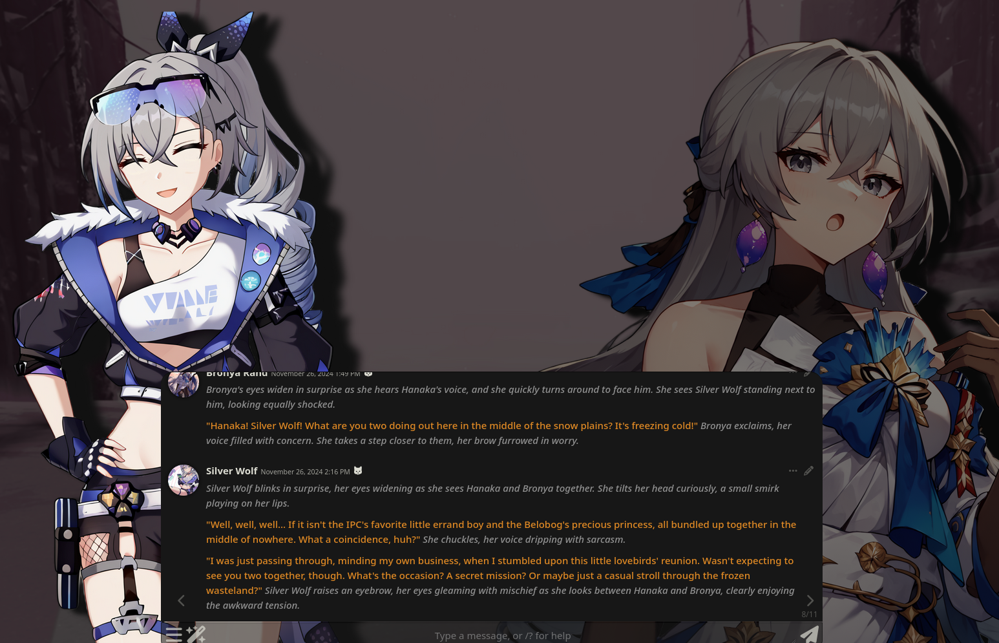
   </center>

5. Sprites de Usuario - ¿Quieres ser parte de la conversación? Presta los sprites de otra persona/personaje o usa los tuyos mientras usas todas las otras características de Prome.

   > [!NOTE]
   > Elige la carpeta predeterminada de sprites de persona en los ajustes de Sprites de Usuario, o usa la Galería de Sprites para anularla en una persona específica. Usa `/express expression=joy` o `/set-user-set name=…` para cambiar tu expresión o conjunto de sprites activo.

   <center>
      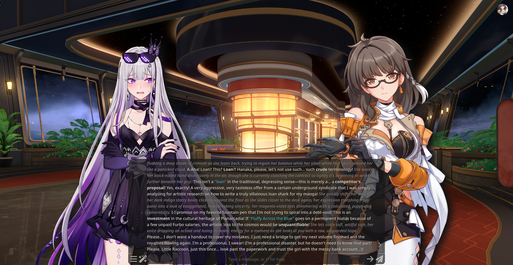
   </center>

6. Emulación de Sprites - Cuando un personaje carece de sprites, Prome puede mostrar el retrato de su tarjeta en chats individuales y de grupo.

   <center>
    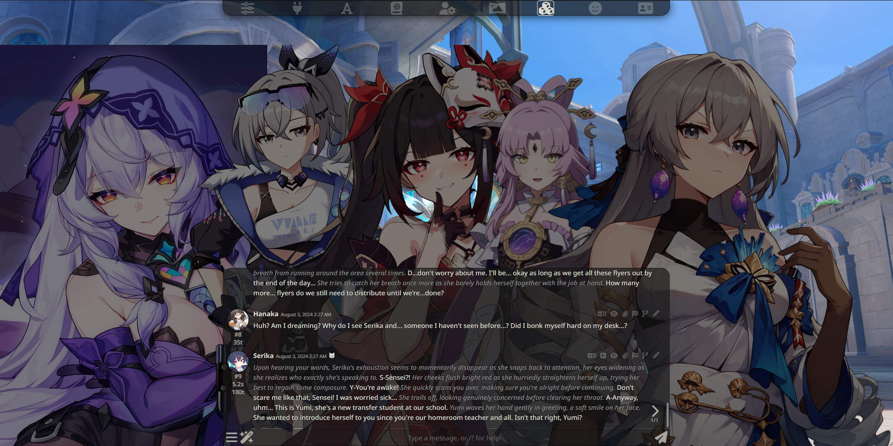
   </center>

7. Modo de Enfoque/Desenfoque - ¿Quieres replicar el enfoque de sprites de algunas novelas visuales como Doki Doki Literature Club? El Modo de Enfoque y/o Desenfoque de Personajes te da la habilidad de hacerlo dentro de tus chats, haciendo saber quién está hablando en cualquier momento.

> [!NOTE]
> La velocidad de la animación y la transición de Enfoque/Desenfoque de los Sprites de Personajes pueden ser ajustadas en el menú de Prome.

   <center>
    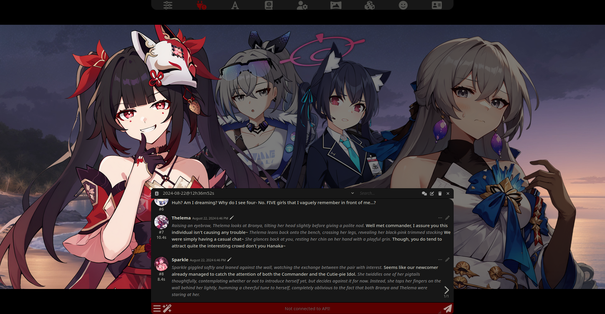
   </center>

8. Esconder Sprites de Personajes Automáticamente (una alternativa a deshabilitar personajes) - ¿Quieres mantener a todos en el chat pero hay demasiadas personajes en pantalla para verlos(las) todos? Dale a Prome un límite de sprites para mostrar en la pantalla de la novela visual! Ya sea que quieras 3, 6 u 8 personajes, Prome esconderá automáticamente a cualquier personaje que no haya participado en la conversación, haciendo que la pantalla sea más fácil de ver.

   <center>
    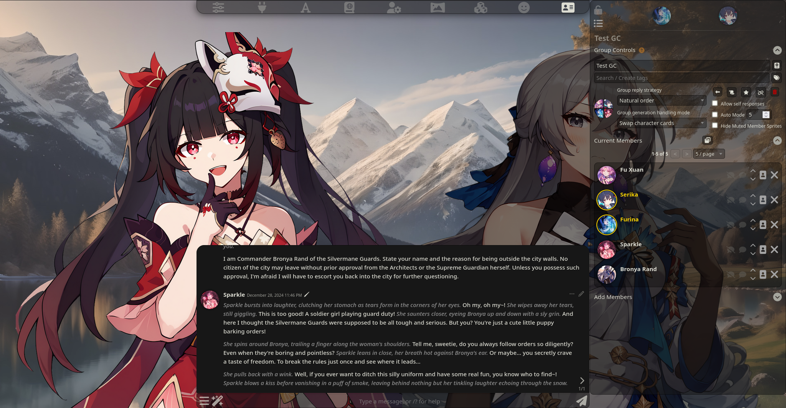
   </center>

9. Sombras y Temblor de Sprites (Emula Hablar) - ¿Quieres un poco más de "realismo" en tus sprites de personajes? Prome tiene la habilidad de imitar a un personaje hablando con un ligero temblor y añadir una sombra al sprite, haciendo que el personaje se mezcle más en el la escena que has elegido!

> [!IMPORTANT]
> El temblor de sprites solo funcionará si `Streaming` está habilitado en la configuración de tu preset. Las sombras de sprites pueden ser ajustadas en las distancias X y Y así como la fuerza de desenfoque.

   <center>
       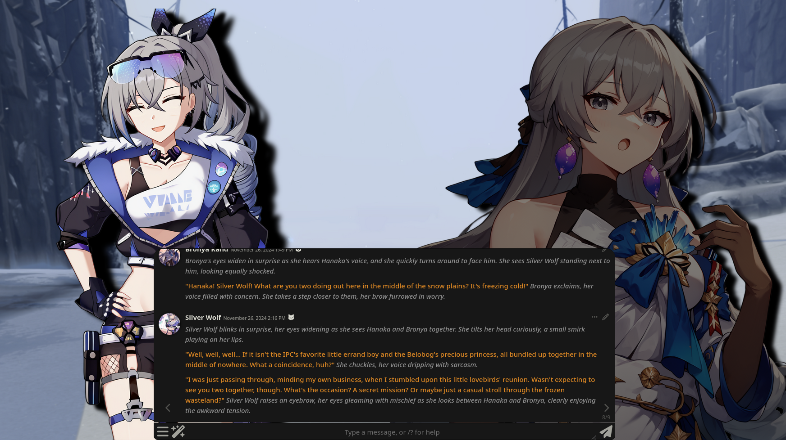
    </center>

10. Escalado de Sprites - ¿Quieres que tus sprites ocupen más o menos espacio en la pantalla? ¡Escálalos hacia arriba o hacia abajo como tú quieras!

> [!NOTE] 
> Este es un escalador global y afectará a todos los sprites en el chat (incluyendo Sprites de Usuario).

|                  Estándar (1.0)                   |                     Reducido (0.75)                     |
| :-----------------------------------------------: | :-----------------------------------------------------: |
| 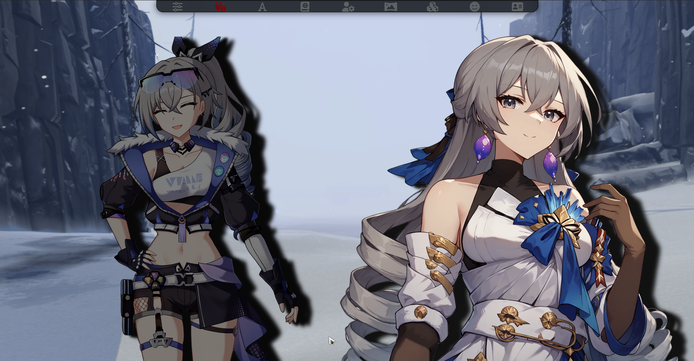 | 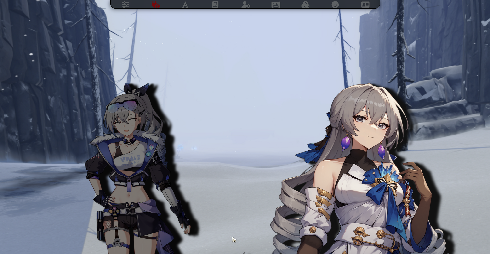 |

11. Modo Letterbox - Haz tu experiencia de novela visual más 'cinematográfica' o 'retro' con letterboxes del pasado!

> [!NOTE]
> Los letterboxes pueden ser renderizados horizontalmente o verticalmente y pueden ser ajustados en tamaño y color en el menú de Prome.

|             Horizontal              |            Vertical             |
| :---------------------------------: | :-----------------------------: |
| 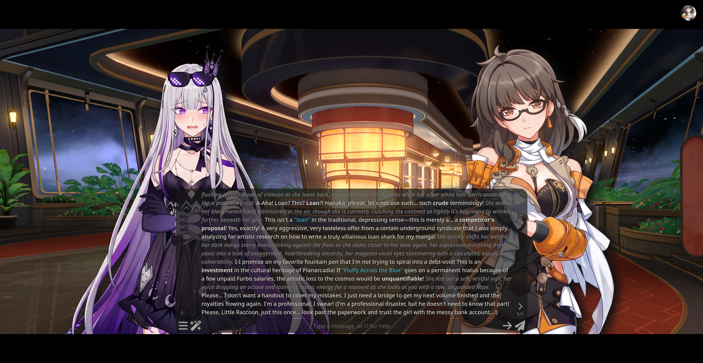 | 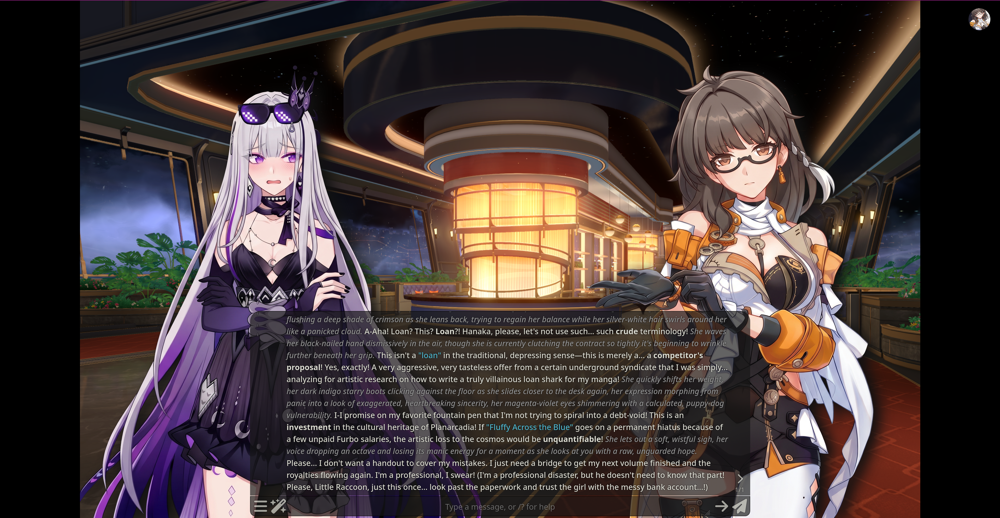 |

12. El Modo de Novela Visual Tradicional muestra un mensaje a la vez en un chat abierto con el escenario de Prome activado. Actívalo en los ajustes de Sheld. Abre el menú de la varita y elige **Show chat history** para abrir el historial de SillyTavern y **Show latest message** para volver a la escena.

13. Visibilidad de Sheld - Esconde el Sheld (Caja de Mensajes) para capturar el momento de un chat.

> [!NOTE]
> Activa o desactiva esta función en los ajustes o con `Alt` + `Mayús` + `H`. `Ctrl` + `F1` también funciona si el escritorio le envía el atajo al navegador.

   <center>
      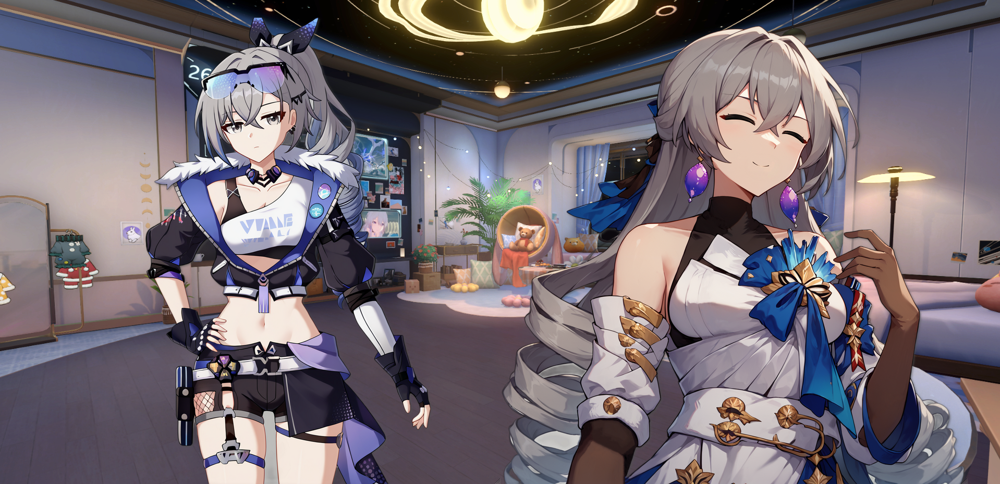
   </center>

La mayoría de las configuraciones de Prome se pueden encontrar en _Extensiones_ > `Prome (Extensión de Novela Visual)`, o haciendo clic en el icono de acceso directo de la varita junto a **Modo Novela Visual** en los Ajustes de Usuario de SillyTavern. También puedes ver todos los comandos slash compatibles (como `/prome-expression`, `/prome-costume` y `/update-layers`) y los atajos de teclado desde la parte inferior del panel de configuración de Prome.

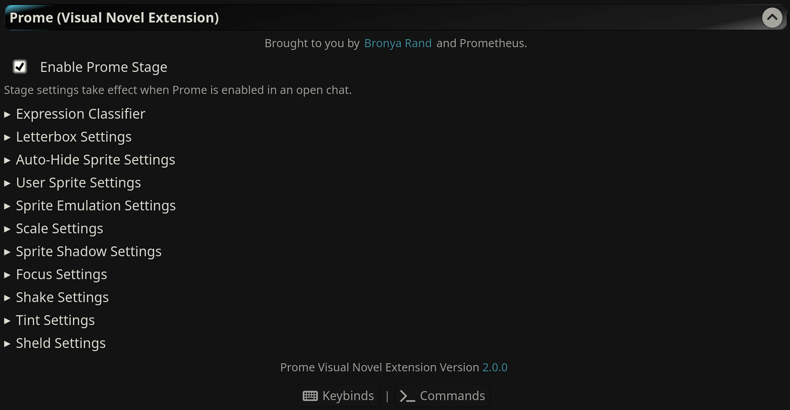

## Requisitos

- SillyTavern con los Perfiles de Conexión habilitados
- La extensión Character Expressions desactivada (o cualquier proveedor externo si usas el de Prome).
- El Modo Novela Visual de SillyTavern desactivado (Ajustes de Usuario -> Modo Novela Visual).

## Instalación

Prome tiene dos ramas para elegir:

1. `master` - La versión estable de Prome que funciona para todas las versiones de SillyTavern (a menos que staging rompa una dependencia de Prome).
2. `dev` - Básicamente una versión beta de Prome donde las cosas que planeo agregar/arreglar van antes de pasar a `master` o después de una actualización de SillyTavern. Puede que no funcione completamente y las cosas pueden cambiar en cualquier momento.

#### Via Download Extensions & Assets (Easiest)

1. Presiona _Extensiones_ y luego **Download Extensions & Assets**.
2. Haz clic en el botón de enchufe rojo y luego en OK.
3. Busca `Prome Visual Novel Extension` y haz clic en el botón de descarga.
4. Actualiza la página de SillyTavern de nuevo.
5. Haz clic en _Extensiones_ nuevamente y haz clic en la flecha hacia abajo en el menú desplegable `Prome (Extensión de Novela Visual)` y activa _Iniciar Prome_.
   > Si ya tienes el Modo Novela Visual activado, puedes omitir este paso.
6. Beneficio.

#### Via Instalar Extensión

1. Presiona _Extensiones_ y luego **Instalar Extensión**.
2. Pega el siguiente **enlace** en el campo de texto y haz clic en Guardar:

   ```
   https://github.com/Bronya-Rand/Prome-VN-Extension
   ```

> [!NOTE]
> Si deseas usar la rama `dev` de Prome, copie o escriba el siguiente texto en el campo de texto _Branch or tag name_:
> ```sh
> dev
> ```

3. Actualiza la página de SillyTavern.
4. Haz clic en _Extensiones_ nuevamente y haz clic en la flecha hacia abajo en el menú desplegable `Prome (Extensión de Novela Visual)` y activa _Iniciar Prome_.
   > Si ya tienes el Modo Novela Visual activado, puedes omitir este paso.
5. Beneficio.

#### Via Git

1. Ve a tu carpeta de extensiones (generalmente en `/data/default-user/extensions`).
2. Abre símbolo del sistema de Windows, Terminal, Windows Powershell, etc. y ejecuta el siguiente comando:

   ```sh
   git clone https://github.com/Bronya-Rand/Prome-VN-Extension
   ```

> [!NOTE]
> Si deseas usar la rama `dev` de Prome, ejecuta este comando en su lugar:
> ```sh
> git clone https://github.com/Bronya-Rand/Prome-VN-Extension -b dev
> ```
3. Actualiza la página de SillyTavern o inicia SillyTavern (si no está activo).
4. Haz clic en _Extensiones_ nuevamente y haz clic en la flecha hacia abajo en el menú desplegable `Prome (Extensión de Novela Visual)` y activa _Iniciar Prome_.
   > Si ya tienes el Modo Novela Visual activado, puedes omitir este paso.
5. Beneficio.

El Prome Visual Novel Extension, el código de la extensión de novela visual Prome, Derechos de autor (c) 2024-2026 Bronya-Rand. Todos los derechos reservados.

<!-- LINK GROUP -->
[cover]: ./prome-open-graph.jpg
