<a name="readme-top"></a>

![][cover]

<div align="center">

**English** | [Español](README-es.md)

</div>

The Prome Visual Novel Extension is a extension for SillyTavern that remodernizes the Visual Novel system by replacing ST's VN Mode and Character Expressions into one dedicated VN system.

## Why Prome?

> Prometheus: _Boom..._

## Features

1. The Prome Stage - Renders its own visual novel stage in individual and group chats, with automatic horizontal overlap and speaker layering when group sprites exceed the viewport width.
   > This feature replaces ST's Visual Novel Mode/Waifu Mode and ST's Character Expressions extension.

2. Expression Classifier - Built-in expression classification supporting **None (Manual)**, **Local (ONNX)**, **Main API (Raw / Structured)**, and **WebLLM Extension** (with automatic fallback to Local). Includes customizable prompts (`{{labels}}`, `{{outputFormat}}`), default/fallback expressions, available-sprite filtering, long-message sampling, and multiple sprites per expression with optional re-rolling.
3. Sprite Gallery & Costume Overrides - A improved version of ST's _Character Expressions_ extension. Browse, search, and manage sprite packs for **both characters and personas**. Upload individual sprites or `.zip` packs, add custom expression labels, pin any group member or persona without waiting for them to speak, and switch outfits on the fly using **Sprite Folder Overrides** (`/Subfolder` or `Folder/Subfolder`) just like the old ST extension.
4. World + Character Tinting - Prome's biggest feature to date. Wanted to make a chat take place in the evening for that special 'date' or experience a post-alter version of a game world, but were unable to get such weather/events to happen (such as a locked day cycle in Honkai: Star Rail)? Now you can by setting the world and/or character colors to be how **YOU** want it to be.

> [!NOTE]
> Tinting choices available are: Blur, Brightness, Contrast, Grayscale, Hue, Invert, Saturate and Sepia. The World Tint can be shared with characters and both tints can be enabled or disabled in the Prome menu.

   <center>
      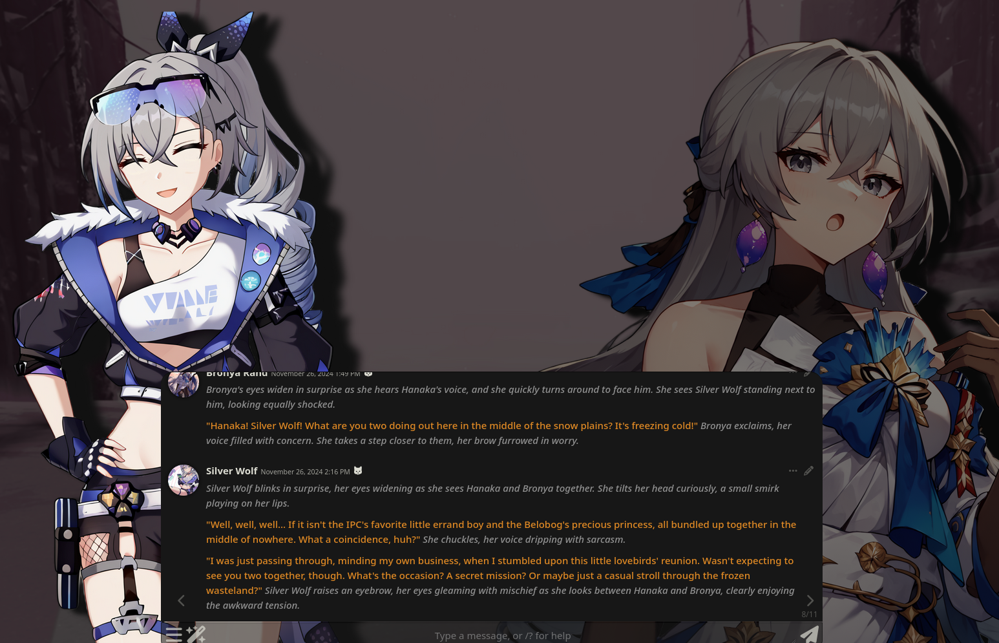
   </center>

5. User Sprites - Want to be part of the conversation? Borrow someone else's sprites or use your own for your own persona whilst using all of Prome's other features!

> [!NOTE]
> > Choose a default persona sprite folder in User Sprite Settings, or use the Sprite Gallery to override it for a specific persona. Use `/express expression=joy` or `/set-user-set name=…` to change your active expression or sprite set.

   <center>
      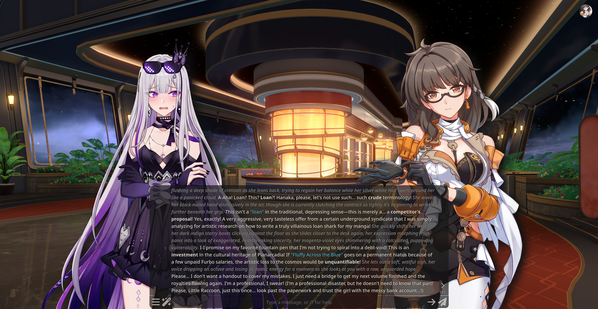
   </center>

6. Sprite Emulation - When a character has no sprite pack, Prome can display their card portrait in individual and group chats.

   <center>
    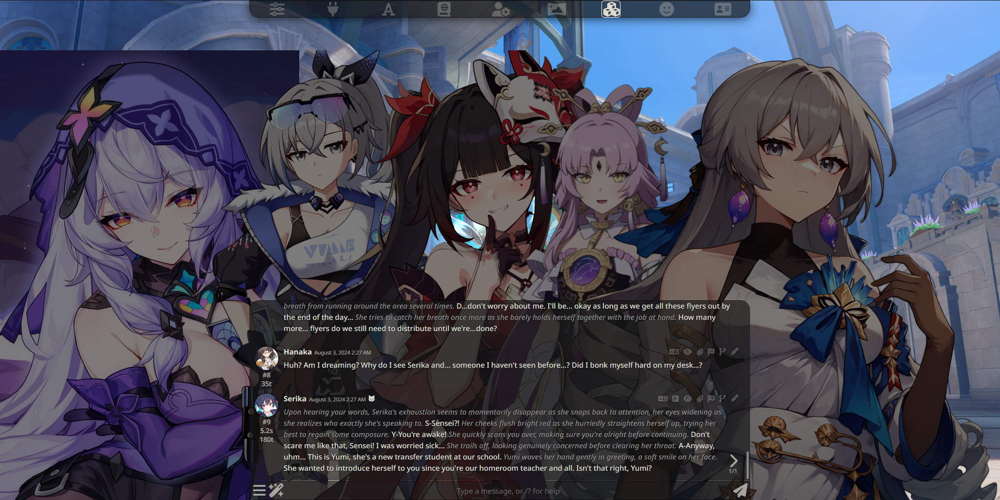
   </center>

7. Focus/Defocus Mode - Want to replicate the sprite focus of some visual novels like Doki Doki Literature Club. Focus Mode and/or Darken Character Sprites gives you the ability to do so within your chats, making it known who is speaking at any given moment.

> [!NOTE]
> The animation speed and transition of Focus/Darken Character Sprites can be adjusted in the Prome menu.

   <center>
    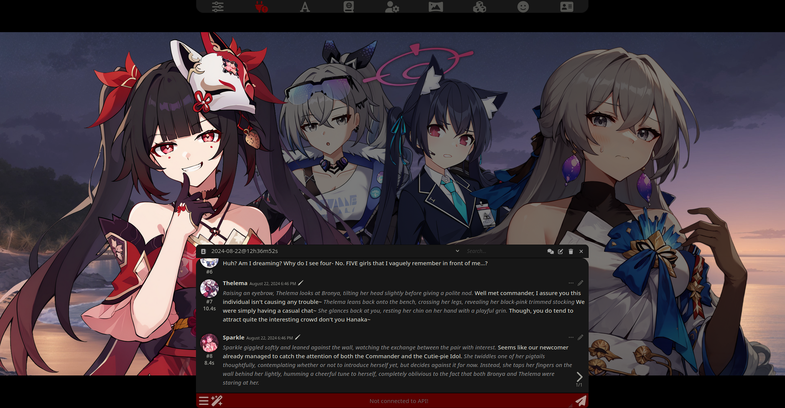
   </center>

8. Auto-Hide Sprites (an alternative to disabling characters) - Wanted to keep everyone in chat but there are just too many people on screen to see them all? Give Prome a limit of sprites to show in the VN screen! Whether you want 3, 6 or 8, Prome will auto-hide anyone who hasn't partaken in the conversation, making the screen easier to see.
   <center>
    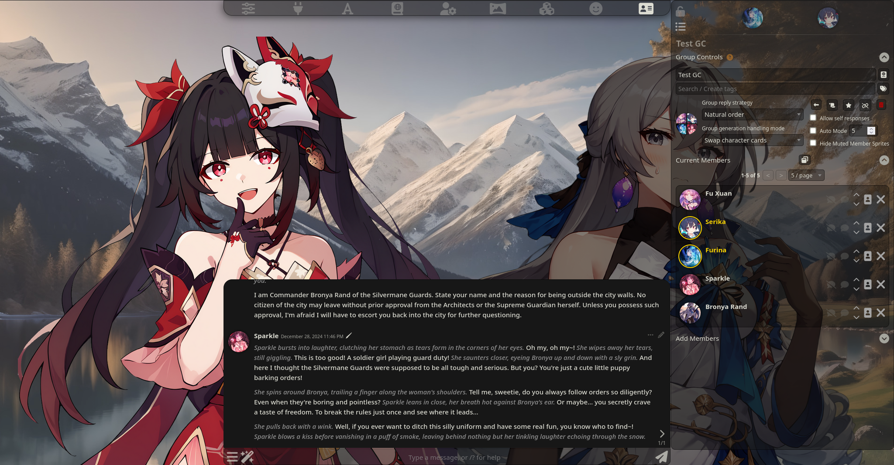
   </center>

9. Sprite Shadows & Shake (Emulates Speaking) - Wanted a bit more "realism" to your character sprites? Prome has the ability to mimic a character talking by shaking the sprite subtly and add a shadow to the sprite itself, making the character blend in more into the environment you've chosen!

> [!IMPORTANT]
> Sprite Shake will only work if `Streaming` is enabled in your preset settings. Sprite Shadows can be adjusted in X and Y distances as well as blur strength.

   <center>
       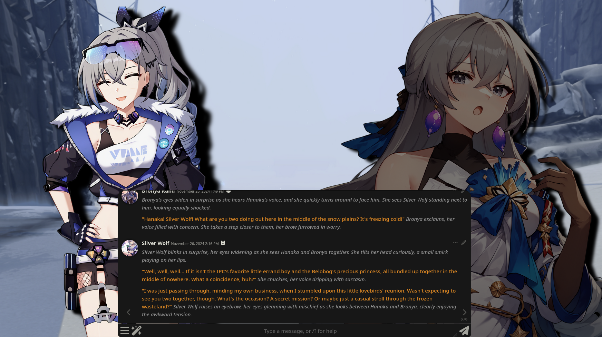
    </center>

10. Sprite Scaling - Want your sprites to take up more or less of the screen? Scale them up or down as you wish!

> [!NOTE] 
> This is a global scaler and will affect all sprites in the chat (including User Sprites).

|                   Default (1.0)                   |                     Reduced (0.75)                      |
| :-----------------------------------------------: | :-----------------------------------------------------: |
| 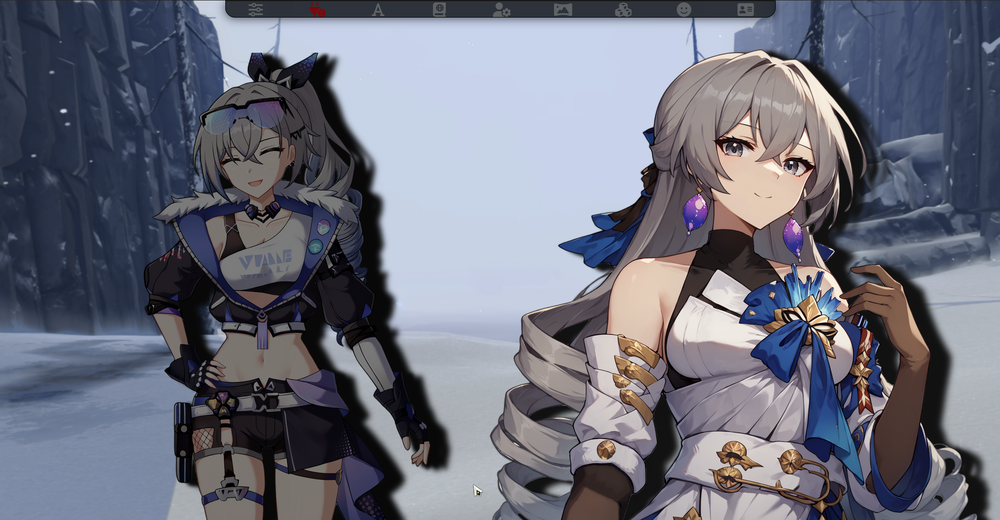 | 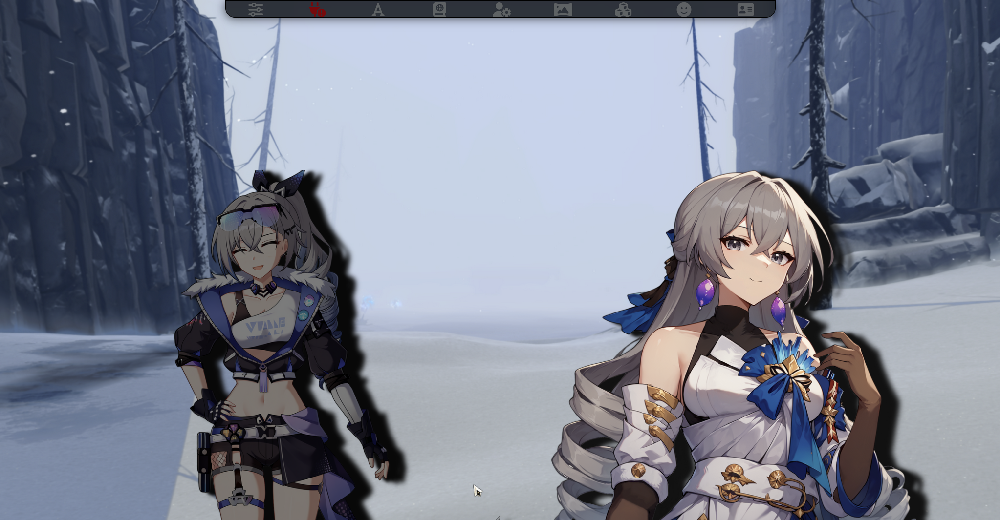 |

11. Letterbox Mode - Make your VN experience more 'cinematic' or 'retro' with letterboxes of the past!

> [!NOTE]
> Letterboxes can be rendered horizontally or vertically and can be adjusted in size and color in the Prome menu.

|             Horizontal              |            Vertical             |
| :---------------------------------: | :-----------------------------: |
| 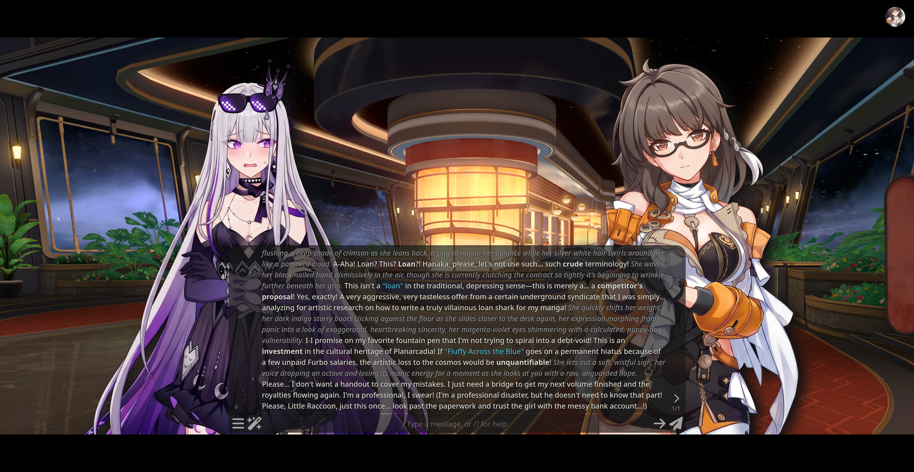 | 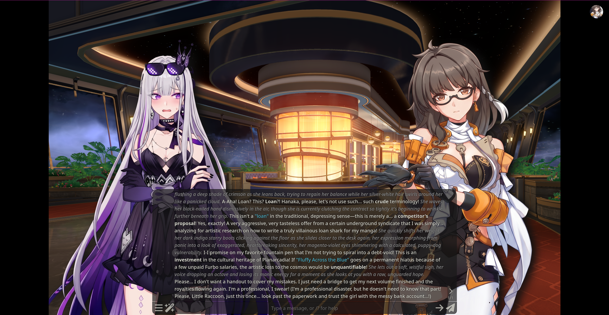 |

12. Traditional VN Mode shows one message at a time in an open chat with the Prome Stage enabled. Turn it on under **Sheld Settings**, then open the wand menu and choose **Show chat history** to open the SillyTavern transcript and **Show latest message** to return to the scene.

13. Sheld Visibility - Hide the Sheld (Message Box) to capture the moment of a given chat.

> [!NOTE]
> Toggle this feature in Settings or press `Alt` + `Shift` + `H`. `Ctrl` + `F1` also works when your desktop passes it to the browser.

   <center>
      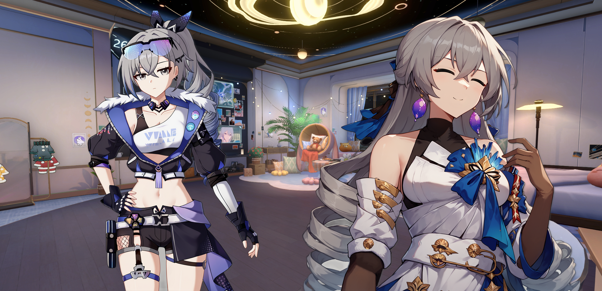
   </center>

Most of Prome's feature settings can be found under _Extensions_ > `Prome (Visual Novel Extension)`, or by clicking the wand shortcut icon next to **Visual Novel Mode** in SillyTavern's User Settings. You can also view all supported slash commands (such as `/prome-expression`, `/prome-costume`, and `/update-layers`) and keybinds from the bottom of the Prome settings drawer.

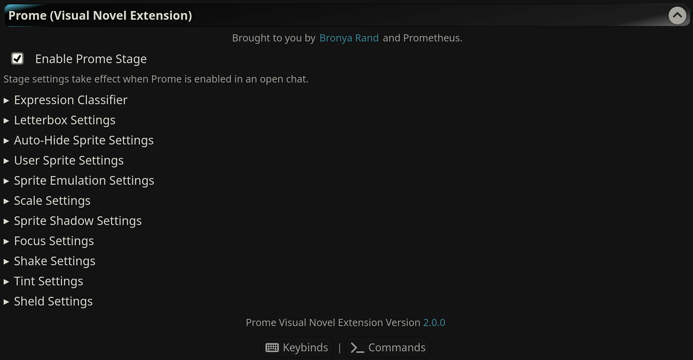

## Prerequisites

- SillyTavern with Connection Profiles Enabled
- Character Expression Extension Disabled (or any third-party extension provider if using Prome's own).
- SillyTavern's VN Mode disabled (User Settings -> Visual Novel Mode).

## Installation

Prome has two branches to choose from:

1. `master` - The stable version of Prome that works for all SillyTavern versions (unless staging breaks a Prome dependency).
2. `dev` - Basically a beta version of Prome where stuff I plan to add/fix go before moving to master or after a SillyTavern update. May not work fully and stuff in it may change at any time.

#### Via Download Extensions & Assets (Easiest)

1. Click _Extensions_ then **Download Extensions & Assets**
2. Click the red power plug button and then OK.
3. Scroll down to find `Prome Visual Novel Extension` and click the Download button.
4. Refresh the SillyTavern page.
5. Click on _Extensions_ again and click down on the `Prome (Visual Novel Extension)` dropdown and toggle _Enable Prome_.
   > If you already have Visual Novel Mode on, you can skip this step.
6. Profit.

#### Via Install Extension

1. Click _Extensions_ then **Install Extension**
2. Paste in the following **link** into the text field and click Save:

   ```
   https://github.com/Bronya-Rand/Prome-VN-Extension
   ```

> [!NOTE]
> If you want to use the `dev` branch of Prome, copy/type the following text into the _Branch or tag name_ field: 
> ```
> dev
> ```

3. Refresh the SillyTavern page.
4. Click on _Extensions_ again and click down on the `Prome (Visual Novel Extension)` dropdown and toggle _Enable Prome_.
   > If you already have Visual Novel Mode on, you can skip this step.
5. Profit.

#### Via Git

1. Go to your extensions folder (usually in `/data/default-user/extensions`).
2. Open Command Prompt, Terminal, Windows Powershell, etc. and run the following command:

   ```sh
   git clone https://github.com/Bronya-Rand/Prome-VN-Extension
   ```

> [!NOTE]
> If you want to use the `dev` branch of Prome, run this command instead: 
> ```sh
> git clone https://github.com/Bronya-Rand/Prome-VN-Extension -b dev
> ```

3. Refresh the SillyTavern page or start up SillyTavern (if it's not running).
4. Click on _Extensions_ again and click down on the `Prome (Visual Novel Extension)` dropdown and toggle _Enable Prome_.
   > If you already have Visual Novel Mode on, you can skip this step.
5. Profit.

The Prome Visual Novel Extension, the Prome Visual Novel Extension Code, Copyright 2024-2026 Bronya-Rand. All rights reserved.

<!-- LINK GROUP -->
[cover]: ./prome-open-graph.jpg
